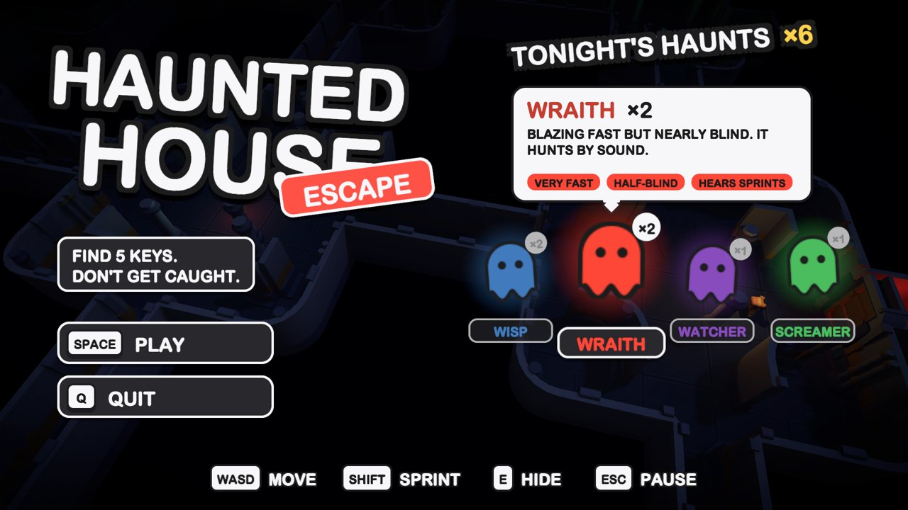
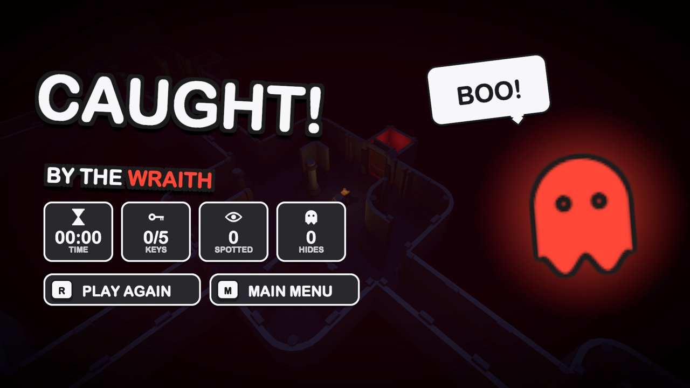

# Haunted House Escape

A low-poly stealth escape game made in Unity 6. Sneak through a 14-room haunted house, find 5 keys hidden in random spots, and reach the exit before the 7-minute timer runs out — without getting caught by the ghosts.

**▶ Play in your browser:** https://darveloff.github.io/haunted-house-escape/

## Controls

| Key | Action |
|---|---|
| WASD / arrows | Move |
| Shift | Sprint (uses stamina, and ghosts can hear it) |
| Esc | Pause |

## The ghosts

| Ghost | Colour | Behaviour |
|---|---|---|
| Wisp ×2 | Blue | Steady patroller, average at everything |
| Wraith ×2 | Red | Very fast but nearly blind — hunts by sound |
| Watcher ×1 | Purple | Slow, but sees across whole rooms |
| Screamer ×1 | Green | Shrieks when it spots you and calls nearby ghosts |

## Features

- Modular map generated from a cell layout (rooms, corridors, auto-picked corner/T/cross pieces)
- NavMesh ghost AI: view cones, line of sight, hearing, last-known-position search
- Cover props to break line of sight, stamina, randomised key locations each run
- Minimap drawn from the NavMesh with a 5-seconds-on / 5-seconds-off ghost radar
- All UI, icons and sound effects generated in code — no imported UI art or audio files
- Per-ghost visual effects (afterimages, sound-wave rings, scanning eye and vision cone)

## Project layout

- `Assets/Editor/HauntedHouseMapBuilder.cs` — **Tools ▸ Haunted House ▸ Build Map** regenerates the whole scene
- `Assets/Editor/WebGLBuilder.cs` — **Tools ▸ Haunted House ▸ Build WebGL** for a local web build
- `Assets/Scripts/` — gameplay (player, ghosts, keys, game flow), `Audio/`, `UI/`

## Cloud build

Every push to `main` builds WebGL with [GameCI](https://game.ci) and deploys it to GitHub Pages (`.github/workflows/webgl.yml`). It needs two repository secrets: `UNITY_EMAIL` and `UNITY_PASSWORD` (a Unity ID login with two-factor authentication off).

## Credits

- 3D models: [Kenney](https://kenney.nl) — Modular Space Kit and Mini Characters (CC0)
- Built with Unity 6000.6
