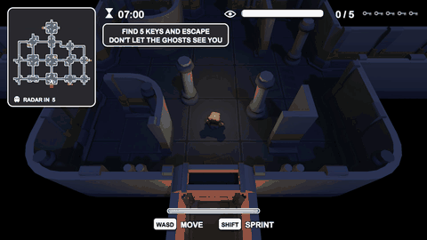

# Haunted House Escape

A low-poly stealth escape game made in Unity 6. Sneak through a 14-room haunted house, find 5 keys hidden in random spots, and reach the exit before the 7-minute timer runs out — without getting caught by the ghosts. Grab the last key and the house wakes up: lights turn red and every ghost converges on the exit.

**▶ Play in your browser:** https://darveloff.github.io/haunted-house-escape/ (keyboard, or touch controls on phones)

## Controls

| Input | Action |
|---|---|
| WASD / arrows · on-screen joystick | Move |
| Shift · RUN button | Sprint (uses stamina, and ghosts can hear it) |
| Esc · pause button | Pause |

## The ghosts

| Ghost | Colour & shape | Behaviour |
|---|---|---|
| Wisp ×2 | Blue, plain | Steady patroller, average at everything |
| Wraith ×2 | Red, horned | Very fast but nearly blind — hunts by sound |
| Watcher ×1 | Purple, one big eye | Slow, but sees across whole rooms |
| Screamer ×1 | Green, open mouth | Shrieks when it spots you and calls nearby ghosts |

Each type also has a distinct silhouette, so they can be told apart without relying on colour.

## Features

- Modular map generated from a cell layout (rooms, corridors, auto-picked corner/T/cross pieces)
- NavMesh ghost AI: view cones, line of sight, hearing, last-known-position search
- Rising tension: ghosts get faster and sharper with every key, then a final **hunt** phase
- Silhouettes show the player and ghosts through walls
- Cover props to break line of sight, stamina, randomised key locations each run
- Best time and a three-star rating (escape · under 4:00 · never spotted), saved per device
- Minimap drawn from the NavMesh with a 5-seconds-on / 5-seconds-off ghost radar
- All UI, icons and sound effects generated in code — no imported UI art or audio files
- Game feel: screen shake, red chase vignette, sprint noise ring, key sparkles, exit-door camera pan
- First-run tutorial tips and on-screen touch controls for phones

## How I built it

**Map generation.** The house is described as a small grid of cells: rooms (3×3, 5×3 or 5×5 cells, one doorway centred on each wall) and corridor paths between doorways. An editor tool walks that layout, works out which sides of each corridor cell are open, and picks the matching kit piece — end, straight, corner, T-junction or crossing — and its rotation from a 4-bit mask. Unused doorways become dead-end alcoves, which double as possible key spots. One menu click (**Tools ▸ Haunted House ▸ Build Map**) regenerates the whole scene: geometry, lighting, NavMesh, player, ghosts and keys.

**Making the kit walkable.** The kit's floors are double-sided, which made Unity's NavMesh bake discard them, so ghosts couldn't path between rooms. The builder generates collider meshes with the downward-facing triangles stripped, adds thin invisible floor boxes per cell, and sizes the agent for the narrow corridor gaps between wall bases.

**Ghost AI.** Each ghost runs a small state machine — patrol → chase → search — on top of a NavMeshAgent. Sight is a view cone plus a line-of-sight raycast; sprinting is heard through walls within a per-type radius. A chasing ghost heads for where it *last saw* you, looks around, then gives up, which is what makes breaking line of sight work. Ghost types are data (speed, sight range, view angle, hearing) in one table, and a game-wide "threat" multiplier scales them as keys are collected.

**No imported UI art or audio.** Rounded panels, icons (keys, eyes, hourglass, per-type ghosts, stars) and the vignette are drawn into textures at startup from signed-distance functions. Every sound — footsteps, moans, heartbeat, shriek, chimes, ambient drone — is synthesised from sine waves and filtered noise when the game loads.

**Cloud build and hosting.** A GitHub Actions workflow builds the WebGL version with GameCI on every push to `main` and deploys it to GitHub Pages. It caches Unity's imported project between runs (about 7 minutes per build) and automatically retries with a clean import if the cache ever breaks the build. A custom web template keeps the game at 16:9 in any window or embed, with a themed loading screen.

## Project layout

- `Assets/Editor/HauntedHouseMapBuilder.cs` — **Tools ▸ Haunted House ▸ Build Map** regenerates the whole scene
- `Assets/Editor/WebGLBuilder.cs` — **Tools ▸ Haunted House ▸ Build WebGL** for a local web build
- `Assets/Scripts/` — gameplay (player, ghosts, keys, game flow), `Audio/`, `UI/`
- `Assets/WebGLTemplates/Responsive/` — the web page the game runs in

## Cloud build

Every push to `main` builds WebGL with [GameCI](https://game.ci) and deploys it to GitHub Pages (`.github/workflows/webgl.yml`). It needs two repository secrets: `UNITY_EMAIL` and `UNITY_PASSWORD` (a Unity ID login with two-factor authentication off).

## Credits

- 3D models: [Kenney](https://kenney.nl) — Modular Space Kit and Mini Characters (CC0)
- Built with Unity 6000.6
